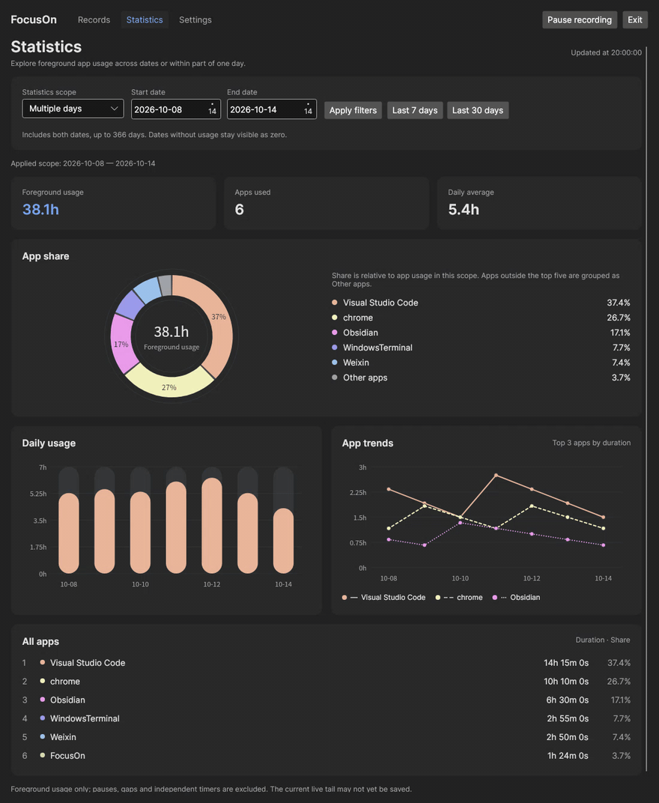
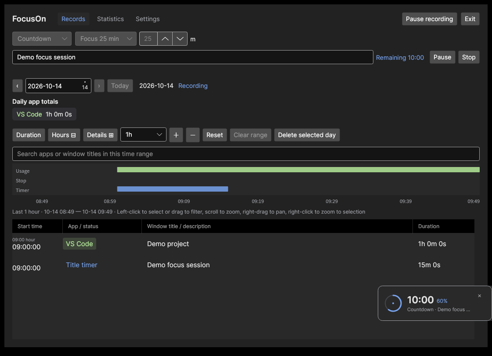
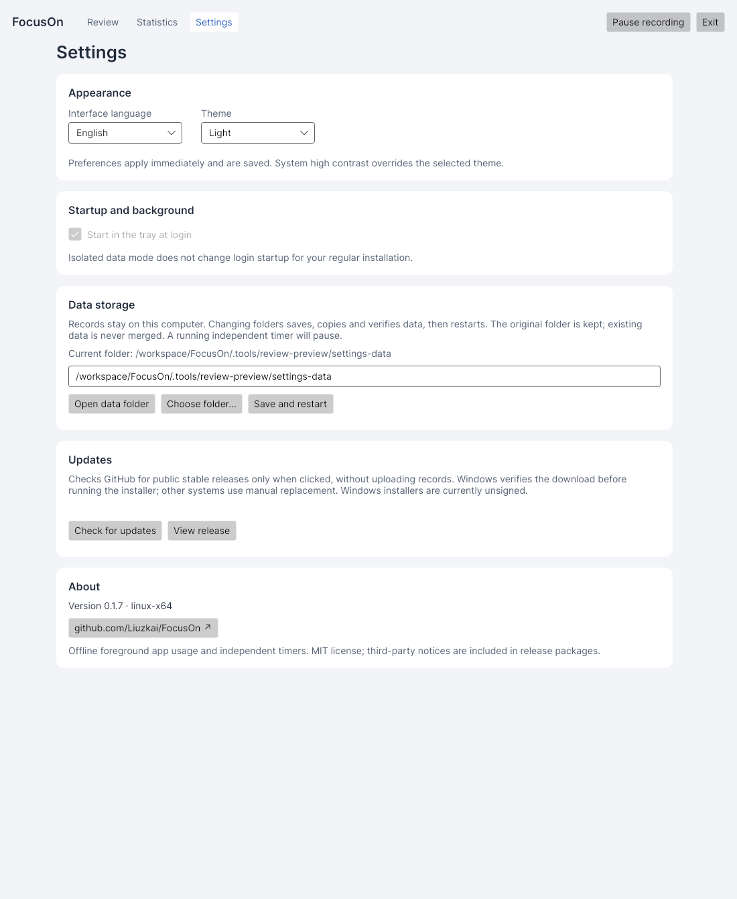

<div align="center">
  
  <h1>FocusOn</h1>
  <p><strong>See where your desktop time goes.</strong></p>
  <p>Offline foreground app tracking, independent timers, and clear usage charts.</p>

  <a href="https://github.com/Liuzkai/FocusOn/releases/latest"></a>
  <a href="https://github.com/Liuzkai/FocusOn/actions/workflows/build.yml"></a>
  <a href="LICENSE"></a>

  <p><a href="https://github.com/Liuzkai/FocusOn/releases/latest">Download</a> · <a href="#features">Features</a> · <a href="#screenshots">Screenshots</a> · <a href="#documentation">Documentation</a></p>
</div>

## Features

- **Records:** app and window history, daily totals, search, and a zoomable timeline.
- **Statistics:** app shares, daily trends, multi-day comparisons, and periods within a day.
- **Timers:** titled stopwatches and Pomodoro-style countdowns, with presets and custom duration.
- **Personalization:** English / 简体中文, Light / Dark themes, and optional hover animations.
- **Desktop integration:** compact timer companion, tray/menu bar, start at login, and one instance per data folder.
- **Local storage:** SQLite history, configurable data location, and updates checked on request.

FocusOn counts the active window, including reading or watching without keyboard input. It measures foreground usage time, not attention.

**New in [v0.1.11](https://github.com/Liuzkai/FocusOn/releases/tag/v0.1.11):** Pomodoro-style countdowns and a compact timer companion.

## Download

**[Get the latest release →](https://github.com/Liuzkai/FocusOn/releases/latest)**

| Platform | Architectures | Availability |
| --- | --- | --- |
| Windows | x64 / ARM64 | `Setup.exe` installer or portable ZIP |
| Linux (glibc) | x64 / ARM64 | `.tar.gz` for a graphical desktop |
| macOS 15+ | Intel / Apple Silicon | Source and native CI validation; signed, notarized downloads pending |

Packages include the .NET runtime. Choose the matching architecture and verify the adjacent `.sha256` file. GitHub's **Source code** archives are for development.

**Windows:** run `FocusOn-win-x64-Setup.exe` on Intel/AMD PCs, or the ARM64 installer on Windows on ARM. Quit the existing tray instance before upgrading; records and preferences are kept. Installers are currently unsigned. [Installation and updates](docs/windows.md).

**Linux:** extract the matching archive and run `./FocusOn` inside its folder. X11 capture is supported; GNOME Wayland needs the bundled extension. Other Wayland desktops can use history and timers, but foreground capture is unavailable. [Dependencies and desktop integration](docs/platforms.md).

## Screenshots

<p align="center">
  
</p>

<details>
<summary><strong>Statistics and hover interactions</strong></summary>

<p align="center">
  
</p>

[Light theme](docs/images/focuson-statistics-hover-light.png) · [简体中文](docs/images/focuson-statistics-hover.zh-CN.png) · [Single-day period](docs/images/focuson-statistics-period.png)

</details>

<details>
<summary><strong>Countdown and compact timer</strong></summary>

<p align="center">
  
</p>

[Timer and platform details](docs/timers.md)

</details>

<details>
<summary><strong>Settings and themes</strong></summary>

<p align="center">
  
</p>

[Dark theme](docs/images/focuson-settings-dark.png) · [简体中文](docs/images/focuson-settings.zh-CN.png)

</details>

Native Linux previews use synthetic demonstration records. Screenshots may show earlier UI revisions.

## Everyday use

1. Open **Records** to explore your timeline. Zoom with the wheel; drag to select a time range.
2. Open **Statistics** for a date range or a period within one day. Hover or focus a chart for details.
3. Use **Settings** for language, theme, hover animations, start at login, data storage, and updates.

Closing the window keeps recording when a usable tray is available. Restore it from the tray or launch FocusOn again. Use **Exit** to save and stop. If no tray is available, the window stays recoverable.

## Privacy and data

History stays on your computer. FocusOn reads active app/window metadata; it does not capture screenshots, document content, or keystrokes. Window titles may contain private information. There is no cloud sync or automatic history cleanup; update checks access GitHub only when requested.

| Platform | Default data folder |
| --- | --- |
| Windows | `%LOCALAPPDATA%\FocusOn` |
| Linux | `$XDG_DATA_HOME/FocusOn` or `~/.local/share/FocusOn` |
| macOS | `~/Library/Application Support/FocusOn` |

Quit before backing up the complete data folder. Settings can copy and verify your data into a new empty folder while preserving the original.

## Documentation

- [Timers and desktop companion](docs/timers.md)
- [Windows installation and updates](docs/windows.md)
- [Platform setup and Linux requirements (中文)](docs/platforms.md)
- [macOS permissions and signing](docs/macos.md)
- [Usage guide (中文)](docs/usage.md)
- [Release workflow, version history, and verification](docs/releases.md)

## Development

Install the .NET SDK pinned in [global.json](global.json). The app uses .NET 10, Avalonia, and Microsoft.Data.Sqlite.

```bash
./build.sh build
./build.sh test
```

On Windows, use `./build.ps1 build` and `./build.ps1 test`. Dependencies use committed lockfiles. For isolated development, run with `--data-dir <test-folder>`; this skips production login startup registration.

[Build and packaging instructions](docs/development.md) · [Architecture decisions](docs/adr) · [Contributing workflow](AGENTS.md)

## License

Original FocusOn code and documentation are [MIT licensed](LICENSE), © 2026 Zhongkai Lau (Liuzkai). Commercial use, modification, and redistribution are permitted with the copyright and full license notice retained; UI attribution is not required.

Bundled components retain their own licenses. See the [third-party notices](docs/licenses/README.md); they are not relicensed under FocusOn's MIT license.
