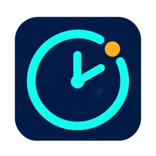
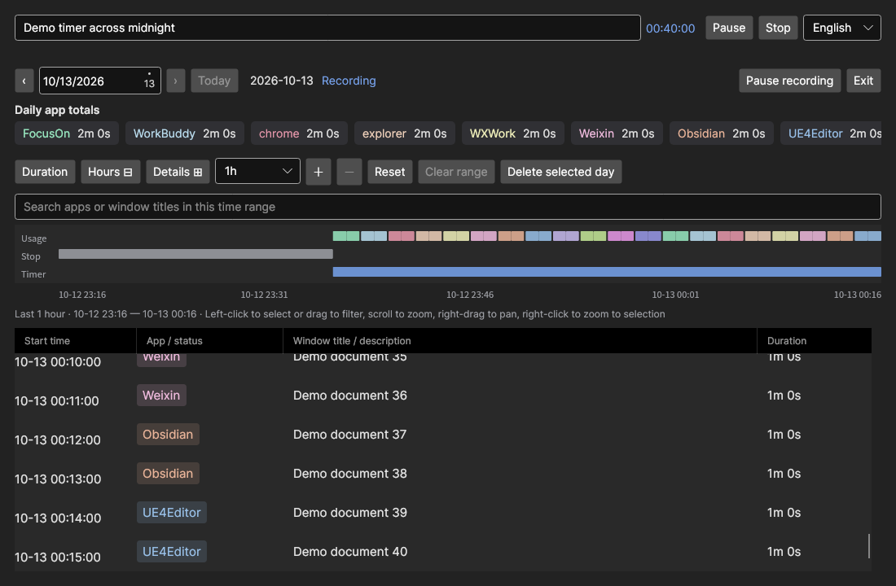
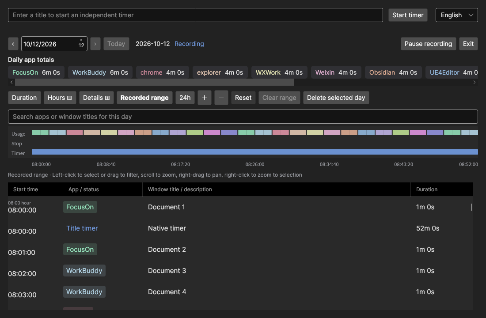
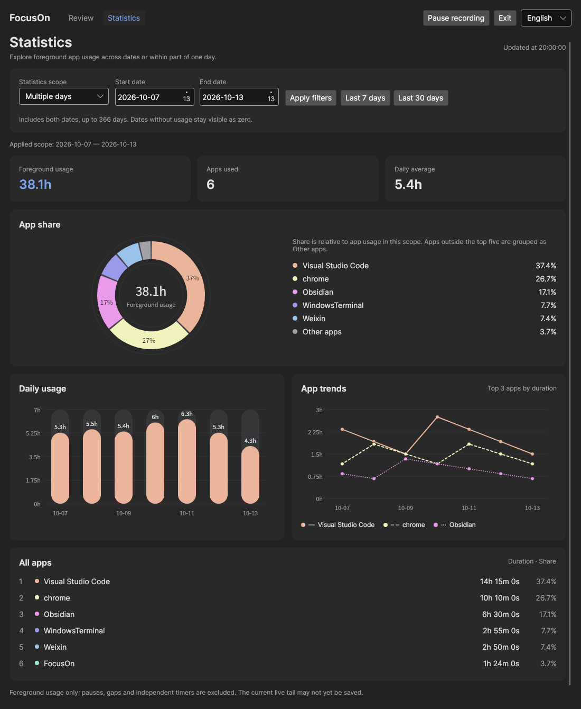

# FocusOn



An offline desktop app for **Windows, Linux, and macOS** that records foreground app usage and provides independent titled timers. Records stay on your computer in a local SQLite database.

FocusOn measures how long an app's window stays active, including reading or watching without keyboard input. It does not measure attention or count background apps.

## Interface



An actual Linux screenshot with synthetic demonstration records, including a timeline across midnight. It does not show personal activity or establish hardware/session acceptance.

The interface supports **English and Simplified Chinese**. Use the language selector in the top row to switch immediately. The preference is saved for the selected data directory; the first launch follows the system language, with English as the fallback. App names, window titles, timer titles, and historical records are preserved in their original language.

[View the Simplified Chinese interface](docs/images/focuson-ui.zh-CN.png).

The **[v0.1.5 release](https://github.com/Liuzkai/FocusOn/releases/tag/v0.1.5)** adds a time range selector: **1h, 2h, 4h, 6h, 8h, 12h, 24h, Today**. Hour ranges look back from now and can cross midnight; Today shows local midnight to now. The default is 1h. Timeline and logs use the visible range, while daily app totals and deletion stay scoped to the date picker. Historical dates use that day's end as their reference; choosing Today returns to the current date. Zoom/pan stays fixed during refresh; Reset restores the selected range and live following.

This release retains pointer-following timeline hints, small separators between different apps, and automatic log-end following. Scroll to the bottom to follow new records; scroll up or select a historical record to pause following.

This release also saves more distinct app colors across restarts and adds right-click zoom to a selected range. Left-click selects a record, left-drag filters a range, the wheel zooms, and right-drag pans. Use **Clear range** or **Escape** to remove the range filter.

**Daily app totals** are compact: drag any app label left or right to scroll, or use the wheel, horizontal trackpad or arrow/Home/End/Page keys. A thin position line appears during interaction and hides after about one second idle, without covering labels or shifting the layout.



This preview shows the native Linux interface with synthetic records; it does not show personal activity or establish hardware/session acceptance. Public v0.1.5 downloads use the verified source described below; earlier releases retain their original builds.

## Statistics preview

The next **v0.1.6 draft** adds a separate Statistics page with a dark donut chart, rounded duration bars, app trend lines and a complete app list. Review and Statistics share the language selector, recording pause and Exit controls. Switching pages keeps recording and independent timers running, and preserves the review's zoom and selection.

- **Multiple days:** choose inclusive start/end dates, or Last 7 / Last 30 days. Ranges support up to 366 dates, including empty days in the daily average.
- **Single-day period:** choose a local date and HH:mm start/end, such as 09:30–12:30. Use 24:00 for the day end or Whole day. Apply filters to update the charts; the applied scope is shown separately from edits.
- App shares count foreground Usage only. Pauses, missing records and independent timers are excluded. Partial intervals use their original monotonic duration allocations. DST and already deleted intervals retain the existing recording rules; future time is not counted.
- Charts show exact-duration details on hover and with Left/Right/Home/End while focused; Escape closes the hint. The top three trends use distinct line patterns, and the complete app list remains readable in high contrast. Narrow windows stack the charts.



Native Linux preview with synthetic records, not personal activity. [Single-day period preview](docs/images/focuson-statistics-period.png) · [Simplified Chinese preview](docs/images/focuson-statistics.zh-CN.png). This new statistics page belongs to v0.1.6; the public v0.1.5 packages keep their original source.

## Features

- Daily app totals and a timeline with separate usage, stopped, and timer lanes.
- Window and title changes recorded as separate segments.
- Independent titled timers with start, pause, resume, and stop controls.
- Date navigation, rolling hour ranges, Today, search, range filtering, zoom, and record details. Filters do not change daily totals.
- Manual recording pause and platform session observation for lock, sleep, and display state.
- Confirmation before deleting a day's records; records on other dates are preserved.
- Local storage, login startup, and activation of the existing instance when launched again.
- Close to the system tray / Mac menu bar, with restore and explicit Exit. If Linux has no usable tray, the window stays visible; losing the tray restores a hidden window.

## Download and run

Download the latest Windows/Linux **[v0.1.5 release](https://github.com/Liuzkai/FocusOn/releases/tag/v0.1.5)**. Windows x64 users can download [FocusOn-win-x64.zip](https://github.com/Liuzkai/FocusOn/releases/download/v0.1.5/FocusOn-win-x64.zip) directly; ARM64 and Linux packages are on the release page. The packages include the .NET runtime; users do not need the SDK. The `.sha256` files let you verify the archives. GitHub's **Source code** downloads are source archives, not runnable apps.

| Platform | Architectures | Package and launch |
| --- | --- | --- |
| Windows | x64, ARM64 | Extract the complete ZIP and run `FocusOn.exe`. |
| Linux with glibc | x64, ARM64 | Extract the complete `.tar.gz` and run `./FocusOn` in a graphical desktop session. |
| macOS 15+ | Intel x64, Apple Silicon ARM64 | Extract the ZIP and move the complete `FocusOn.app` to `/Applications`. Availability and trust status are recorded per build. |

Packages listed here describe the supported build targets. Availability depends on the assets attached to each release. Linux assets appended to the existing Windows `v0.1.0` release use the cross-platform source commit recorded in their `manifest.json` and release notes; the original Windows tag and assets remain unchanged.

Linux X11 foreground capture requires a desktop session with X11 and systemd-logind. Debian/Ubuntu graphical dependencies commonly include `libx11-6 libxext6 libice6 libsm6 libfontconfig1 libgl1`. GNOME Wayland requires the bundled extension in `gnome/focuson@focuson.local/`; see the [platform guide](docs/platforms.md) for installation. Other Wayland desktops can use history and titled timers, but foreground capture is unavailable.

macOS requires permission in **System Settings → Privacy & Security → Accessibility**, followed by a restart. Screen Recording permission is not requested. The native backend uses NSWorkspace, Accessibility, IOKit power notifications and CoreGraphics session/display queries. History and independent timers remain available when foreground permission is denied. See the [Mac installation, permissions and signing guide](docs/macos.md).

An ordinary first launch registers login startup for the current user. Closing the window keeps recording and timers alive. Restore it from the tray/menu bar, the Mac Dock, or by launching the same data directory again. Choose **Exit FocusOn** in the tray/menu bar, **Exit** in the window, or native Mac **Quit** to save and stop. Only one writer and tray icon are created per data directory.

Linux uses StatusNotifierItem. GNOME requires a tray host such as an AppIndicator extension, independently of the foreground capture extension. Without a confirmed host and registered icon, Close keeps the window visible with an explanation; it also reappears if the host disappears. Legacy XEmbed alone is unsupported by the current Avalonia backend. Run `python3 install-desktop.py` from a fixed extracted package location to register the supplied icons and application-menu entry for your user.

For detailed operation and platform requirements, see the [usage guide](docs/usage.md), [platform guide](docs/platforms.md), and [manual acceptance checklist](docs/manual-acceptance.md). These supporting documents currently use Chinese.

## Data and privacy

| Platform | Default data directory |
| --- | --- |
| Windows | `%LOCALAPPDATA%\FocusOn` |
| Linux | `$XDG_DATA_HOME/FocusOn`, or `~/.local/share/FocusOn` |
| macOS | `~/Library/Application Support/FocusOn` |

The existing Windows SQLite data remains compatible. Exit the old version before upgrading or backing up the complete data directory. Window titles can contain private information; FocusOn records titles but does not capture screenshots, document content, or keyboard input. There is no cloud sync or automatic history cleanup.

Use a separate data directory for development or demonstrations; this also skips login startup registration:

```bash
./FocusOn --data-dir /tmp/focuson-demo
```

On Windows, run `FocusOn.exe --data-dir <test-directory>` instead. Language preferences are stored in `settings.json` alongside the database, independently of recording history.

## Development

Use the .NET SDK pinned by [global.json](global.json), currently **10.0.401**. The app uses .NET 10, Avalonia 11.3, and Microsoft.Data.Sqlite. Restoring dependencies requires a network connection; the installed app runs offline.

Windows PowerShell:

```powershell
./build.ps1 build
./build.ps1 test
./build.ps1 publish -Runtime win-x64
```

Linux / macOS:

```bash
./build.sh build
./build.sh test
./build.sh publish linux-x64  # Use osx-x64 or osx-arm64 on macOS.
```

The scripts prefer a repository SDK in `.tools/dotnet/`, then the SDK on `PATH`. Dependencies use committed lockfiles. `test` runs the core/platform SQLite regressions and headless Avalonia UI tests on all supported operating systems. Native Linux window capture and cross-process activation can be checked in an isolated X11 display:

```bash
xvfb-run -a ./build.sh smoke
```

`publish` requires a clean, committed working tree. It creates a self-contained directory, archive, per-file manifest, and archive SHA256 under `artifacts/release/`. Supported runtime identifiers are `win-x64`, `win-arm64`, `linux-x64`, `linux-arm64`, `osx-x64`, and `osx-arm64`. Unix archives preserve executable permissions.

For uncommitted development checks, use `./build.sh package-check <runtime>` or `./build.ps1 package-check -Runtime <runtime>`. These outputs go to `artifacts/validation/` and are marked as development validation; they are not formal committed releases.

## GitHub release automation

The [desktop build workflow](.github/workflows/build.yml) uses standard GitHub-hosted public-repository runners: Windows x64/ARM64, Ubuntu x64/ARM64, Intel Mac and Apple Silicon. It restores locked dependencies, runs regressions and native desktop checks, then verifies self-contained archives, icons and SHA256. Its **Actions artifacts expire after seven days**; they are validation downloads, not Release attachments. Mac builds without Apple credentials are ad-hoc validation bundles and are not formally ready.

The [desktop release workflow](.github/workflows/release.yml) accepts an explicit version tag or manual dispatch with an existing tag. Build/test/package verification must all succeed before it uploads anything. The tag, application version and every attached package source must agree. Releases stay **drafts**, and assets are never silently overwritten. Ordinary code pushes do not publish releases. See [release instructions](docs/releases.md) for exact steps, runner scope and Apple Secrets.

The historical Linux append workflow remains manual and defaults to the already published `409cb51` source for `v0.1.0`. That tag and all existing Windows/Linux attachments are preserved. The new icon/residency version was built separately as `v0.1.1` and published on explicit user approval; no old tag is rewritten.

Developer ID signing, hardened runtime, minimal .NET JIT entitlements, Apple notarization, app stapling and Gatekeeper checks are configured for native Mac runners. They require an existing Apple Developer Program membership and securely configured Actions Secrets. Missing credentials exclude Mac assets from Release uploads. Successful signing and notarization still require physical desktop, Accessibility and power acceptance; see [Mac validation](docs/macos.md).

Linux release notes record the exact source commit and validation scope. Cross-compilation and automated tests do not replace real-device checks for permissions, sleep, lock, tray behavior, DPI, or ARM64 startup.

## Source layout

- `src/FocusOn.Core/`: recording rules, SQLite persistence, daily projection, titled timers, and display text.
- `src/FocusOn.Platforms/`: native foreground/session observers, data paths, single instance, login startup, and language preferences.
- `src/FocusOn/`: the shared Avalonia desktop interface, timeline, and tray.
- `tests/`: core/platform regressions, headless UI tests, and native X11 smoke checks.

Product rules and work items are maintained in the [specification](.scratch/focuson/spec.md) and [local issue tracker](.scratch/focuson/issues). See [ADR 0003](docs/adr/0003-cross-platform-desktop.md) for platform boundaries and the [verification record](tests/FocusOn.Tests/Verification.md) for actual results and remaining device checks.

## License

Original FocusOn code and accompanying original documentation are licensed under the [MIT License](LICENSE), copyright 2026 Zhongkai Lau (Liuzkai). Copies or substantial portions must retain the copyright and full license notice. Attribution in the application interface is not required.

Third-party components and content retain their own licenses and notices. The .NET runtime, Avalonia, SkiaSharp, Inter fonts, Microsoft.Data.Sqlite, SQLite, and test dependencies are not relicensed by this project's MIT license.
